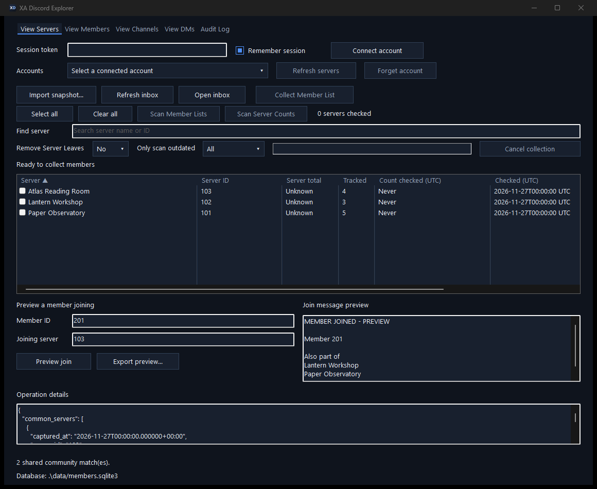
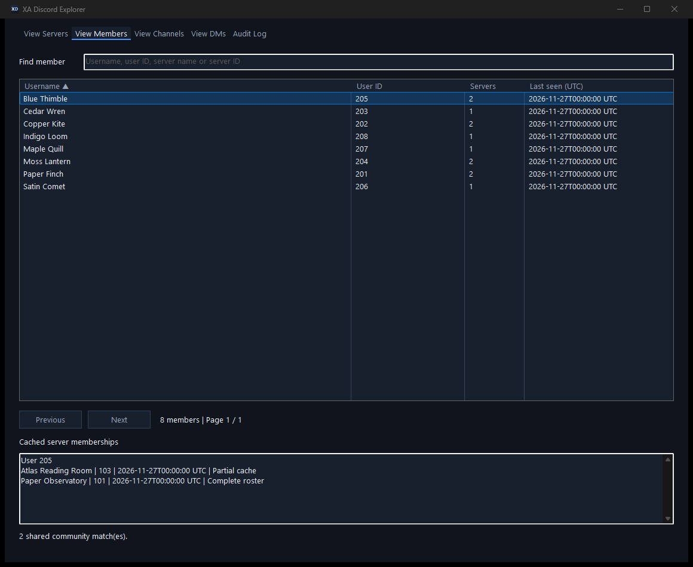

# XA Discord Explorer

XA Discord Explorer is a Windows desktop app for finding shared Discord communities and reviewing the activity you can access across your connected accounts. Import a roster to explore memberships offline, or connect an account to refresh its servers.



## Explore a workspace

- **View Servers** shows roster coverage and when each server was checked. Use **Preview join** to see which other communities a member shares with you. The preview stays local.
- **View Members** searches cached usernames, user IDs, and servers. Select a member to see their observed memberships and last-seen times. A partial roster can confirm a match, but a missing name does not establish that someone left.
- **View Channels** and **View DMs** let you choose conversations, collect accessible messages, and search saved history. **Audit Log** shows moderation actions for servers where your account has audit-log access.



Both screenshots use invented communities and members in an isolated workspace.

## Build and run

On Windows, install Python 3.10 or later, CMake 3.24 or later, and Visual Studio 2022 C++ Build Tools with the Windows SDK. From the project folder, run the following command to build the x64 executable and run its native tests.

```powershell
python 1.build.py --no-pause
```

Open **XA Discord Explorer.exe** beside the build script. To try it offline, save the example below as a JSON file and choose **Import snapshot...**. For your own snapshots, use the actual capture time and set `complete` to `true` only for a complete roster. A newer complete import can remove members missing from that snapshot.

```json
{
  "server_id": "101",
  "server_name": "Paper Observatory",
  "captured_at": "2026-01-15T12:00:00Z",
  "complete": false,
  "members": [{"user_id": "201", "username": "Paper Finch"}]
}
```

## Local data

Memberships and collected messages are saved locally. **Remember session** encrypts saved credentials for the current Windows user using DPAPI. Keep the whole working folder private when exchanging snapshots or builds. Git includes only the named source files, resources, documentation, and mock screenshots. Session credentials, databases, inbox files, downloads, reports, logs, and backups are excluded.

## License

XA Discord Explorer is licensed under the [Apache License 2.0](LICENSE). Bundled dependencies retain their [respective licenses](third_party/sources.txt).
